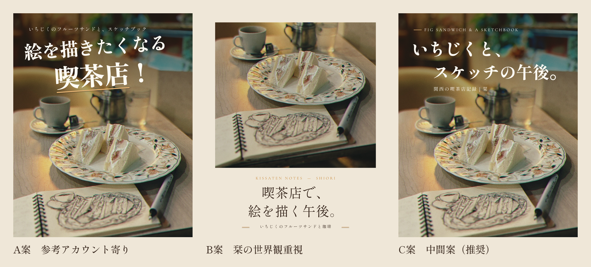

# 栞｜関西の喫茶店記録 — サムネイル制作レポート

第1弾の素材は「いちじくのフルーツサンド × スケッチブック」。テーマは「喫茶店で絵を描きながら過ごす、静かな午後」です。

## 納品物

| 種類 | ファイル |
|---|---|
| Canva編集用PPTX（3案まとめ） | `out/shiori_thumbnails_ABC.pptx` |
| Canva編集用PPTX（案ごと） | `out/shiori_thumb_A.pptx` / `_B` / `_C` |
| 再利用テンプレート（3レイアウト） | `out/shiori_template.pptx` |
| 各案のプレビュー | `out/preview_A.png` / `_B` / `_C` |
| 3案の横並び比較 | `out/compare_ABC.png` |
| プロフィールグリッドでの見え方（3:4表示を約130px幅で再現し、3倍に拡大） | `out/grid_simulation_x3.png` |
| テンプレートのプレビュー | `out/template_preview_A.png` / `_B` / `_C` |
| 個別素材（写真のトリミング・オーバーレイPNG） | `out/assets/` |
| 生成スクリプト | `build.py`（レイアウト定義）・`render.sh`（描画と検証）・`compose.py`（比較画像の作成） |

プレビューPNGは、PPTXそのものをLibreOfficeで描画したものです（PPTXとは別に画像を作ったものではありません）。Canvaに取り込んだ場合も同じ配置になるように作っています。ただし、Canvaへの取り込みそのものはこの環境から実行できなかったため、まだ確認できていません（後述）。

---

## 1. 参考アカウントのデザイン分析

### 確認できたこと・できなかったこと
- **Instagram（@ctyahnpstn）**：この作業環境からは表示できませんでした。そのため、フォロワー数の推移、閲覧数、各投稿の反応は**確認しておらず、この分析には使っていません**。ご提示いただいた「約1ヶ月半で7,000人以上」も未確認の前提として扱っています。
- **参考Canvaデザイン**（canva.link/j02nlh6w02ug9b1）：開いて確認しました。1080×1920のリールカバーで、構成は「donuts（筆記体・傾き）＋はお好き？＋大阪・本町（太い白文字）」です。
- あわせて、Canva内にある同じ型のカバー（Hamburg／Pudding、4:5版も含む）と、栞の既存リールカバー（「デジャーブ」縦書きキャプション型）も確認しました。
- ご指摘の「チェックで可愛い喫茶店」「海みたいなクリームソーダ」の実物は確認できていません。この2点は、いただいた説明をもとに分析しています。

### デザインの構造（確認できた範囲）
1. **3階層の文字組み**：欧文の筆記体（味付け）→ 小さい日本語（問いかけ）→ 大きな太字（地名）。ひと目で読む部分は大見出しだけに絞り、他の文字は装飾として働いています。
2. **傾きの使い分け**：筆記体だけを約−20°傾け、大見出しは水平のままです。動きを一点に集めることで、静止画にリズムを出しつつ読みやすさを保っています。
3. **文字の位置**：写真の上部、暗く背景がボケている部分に置いています。主役の料理には文字をかぶせず、写真が「文字の下地」と「主役」の二役を担っています。
4. **写真の質感**：ややアンバー寄りで粒子のあるフィルム調です。手元（フォーク、指先）を入れて、人の気配を出しています。
5. **型の固定**：複数の投稿が同じ型（○○はお好き？＋地名）です。グリッドに並んだとき「シリーズ」に見え、プロフィールに来た人に「続きがある」ことが伝わります。

### マーケティング上の仕組み（いただいた説明＋上記からの考察）
- **テーマが入口**：店名を入口にすると、その店を知っている人にしか届きません。「チェックで可愛い」「海みたい」のように**感情や形容が入口**なら、店を知らない人にも届きます。新しいフォロワーを得るのに有利な構造です。
- **一瞬で読める太い白文字**：発見タブやリールのフィードでは、目に留まるのはおそらく1秒未満です。読む前に意味が届く大きさと太さが必要です。
- **発信者の人格**：喫茶店の情報だけなら他のアカウントで足ります。イラスト・旅・ファッションなどから「この人の目線」が見えることが、フォローする理由になります（保存は情報に、フォローは人格に紐づくと考えています）。
- **シリーズ・カルーセル**：保存とプロフィール訪問の理由になります。

### 栞が取り入れるもの・取り入れないもの
| 取り入れる（伸びる構造） | 取り入れない（参考アカウント固有の表現） |
|---|---|
| テーマ・感情を入口にしたコピー | 「○○はお好き？」の型そのもの |
| グリッドで読める大きさの見出し | 筆記体の欧文ロゴ風の装飾 |
| 上部の暗部に文字、主役には文字を重ねない | 地名を最大の文字にする構成 |
| 型を固定してシリーズに見せる | ポップな丸ゴシックの雰囲気 |
| 手元・スケッチ・持ち物で人の気配を出す | — |

---

## 2. 栞のサムネイルデザイン方針

**一言で言うと**：「本に挟まれた一枚」。読みやすさは参考アカウントの水準を保ち、温度は栞のものにします。

- **主役はひとつ**：今回はいちじくサンドの断面とスケッチです。文字はこの2つにかからない上部の暗部か、写真の外の余白に置きます。
- **スケッチは隠さない**：スケッチは、顔を出さない栞にとっての「人格」です。下部の明るい紙の上には文字を置きませんでした。
- **写真には手を加えない**：トリミングとリサイズだけで、色補正・暖色補正・AI的な加工はしていません。文字の下地は、写真とは別の半透明オーバーレイで作っています（Canvaで透明度を変えたり削除したりできます）。
- **黒ではなく茶**：オーバーレイも文字の影も黒ではなく、深いブラウン `#24180F` を使い、琥珀色の空気を壊さないようにしています。
- **白は純白にしない**：文字色は少しだけアイボリーに寄せた `#FFFBF3` です。デジタルっぽい硬さを抑えます。
- **プロフィールグリッドは3:4表示を前提**：4:5の投稿はグリッドで左右が約34pxずつ切れます。文字は左右とも70px以上内側に収めています。

---

## 3. 3案の概要



### A案：参考アカウント寄り「絵を描きたくなる / 喫茶店!」
- 書体は**しっぽり明朝 Bold**の大サイズ（112px／156px）。太い明朝で、ゴシックの強さと明朝の品のあいだを狙いました（当初はZen Old Mincho Blackで設計しましたが、Canvaにないフォントのためゴシックに置き換わることを確認し、変更しました）。
- タイトル全体を**−4°**傾け、2行目を170px字下げして動きを出しています。2行目「喫茶店!」は1行目の約1.4倍の大きさです。
- 琥珀色のアンダーライン（6px）で視線を「喫茶店」に集めます。
- サブタイトルは小さく、タイトルの上に置いて内容を補足しています。
- 狙い：ひと目で伝わる強さ。発見タブで最も目に留まりやすい案です。

### B案：栞の世界観重視「喫茶店で、/ 絵を描く午後。」
- 写真をアイボリーの紙に置き、下の余白に明朝で二行を組みました。**本の頁、または栞そのもの**のような見え方です。
- 書体は**しっぽり明朝 Medium**、ダークブラウン。欧文アイブロウ「KISSATEN NOTES — SHIORI」はCormorant Garamondです。
- 写真の部分は、主役（サンドとスケッチ）が最も大きく見えるようにトリミングしています。
- 狙い：グリッドに並んだときの統一感とブランドの格。上品ですが、フィードでの瞬発力はA・Cに劣ります。

### C案：中間案「いちじくと、/ スケッチの午後。」
- 書体は**しっぽり明朝 Bold**。2行目を128px字下げした段違いの組み方で、傾けずに静かな動きを出しています。
- 欧文アイブロウ「FIG SANDWICH & A SKETCHBOOK」と琥珀色の短い線で、雑誌の目次のような品を添えました。
- 署名として「関西の喫茶店記録｜栞」を入れ、どの投稿にも同じ位置に置くことでシリーズとして認識されるようにしています。
- 狙い：題材（いちじく）と過ごし方（スケッチ）が一読で伝わり、明朝の品も残る案です。

### より強いコピーの提案
| 用途 | コピー | ねらい |
|---|---|---|
| A系（強め） | 「描きたくなる、いちじくサンド。」 | 主役名を入れて検索性と具体性を上げる |
| A系（参加型） | 「喫茶店で、絵を描いてみた。」 | 体験の報告。行動の真似を誘い、保存されやすい |
| C系（推奨候補） | 「いちじくサンドを、描く午後。」 | C案の品を残しつつ、主役を一語で示す |
| B系（余韻） | 「珈琲が冷めるまで、描いていた。」 | 栞の文学性。シリーズの2本目以降に向く |

---

## 4. デザインルール（テンプレート共通）

### カラー
| 名前 | HEX | 用途 |
|---|---|---|
| アイボリー（紙） | `#EFE7D8` | B型の背景 |
| アイボリー（明） | `#F3ECDF` | 予備・カルーセル内頁 |
| 文字の白 | `#FFFBF3` | 写真上の文字（純白は使わない） |
| ダークブラウン | `#3A2A20` | 紙の上の文字 |
| 深いブラウン（影） | `#24180F` | オーバーレイ（黒の代わり） |
| 琥珀 | `#C98B3E` | 紙の上の装飾線・アイブロウ |
| 琥珀（明） | `#E3B172` | 写真上の装飾線 |
| くすみボルドー | `#6E2F35` | 差し色（季節の企画・シリーズ名などに少量） |

### フォント・文字サイズ（1080×1350pxのキャンバス基準）
| 役割 | 推奨フォント | サイズ | 字間 | 行送り |
|---|---|---|---|---|
| A型メイン | しっぽり明朝 Bold | 112px / 強調行 156px | −4px | 1.04 |
| B型メイン | しっぽり明朝 Medium | 80px | +2px | 1.16 |
| C型メイン | しっぽり明朝 Bold | 102px | −2px | 1.14 |
| サブタイトル | しっぽり明朝 Regular〜Medium | 24〜30px | +4〜5px | 1.0 |
| 欧文アイブロウ | Cormorant Garamond（大文字） | 24〜26px | +6〜7px | 1.0 |

- **メインタイトルは最小80px**。これより小さいと、グリッド表示（約130px幅）で読めません（`grid_simulation_x3.png` で確認済み）。
- 1行は**8文字まで**を目安にします。9文字以上になったら改行するか、言葉を削ります。
- 改行は意味の切れ目（読点の後）で行います。助詞だけが次の行に落ちないようにします。
- 文字の要素は**3つまで**（アイブロウ／タイトル／サブ）。

### 余白・配置
- 外側の余白：左右とも**70px以上**（3:4グリッドで約34pxずつ切れるため）。
- 写真上の文字は**上部0〜480px**の暗い部分に置きます。主役の料理には重ねません。
- 下部の明るい部分（テーブル・紙）には白文字を置きません。読めなくなります。
- B型の写真枠：四辺56px。文字の領域は下部の約420px。
- 傾きは**A型のタイトルだけ、−3〜−5°**。ほかの要素は傾けません。

### 写真
- 色補正はしない（または撮影時のフィルム調のまま）。オーバーレイは別レイヤーで調整します。
- 主役は画面の中段から下段に置き、上部に背景のボケ（文字を置く場所）を残して撮ると、テンプレートにそのまま収まります。

---

## 5. Canvaでの使い方とフォント互換性

### Canvaに取り込み済みのデザイン
| 内容 | 編集リンク |
|---|---|
| A・B・C案（3ページ） | https://www.canva.com/d/dM-WEHmQ6zn4-js |
| テンプレート（A・B・C型） | https://www.canva.com/d/fLlalmDSDg2Sqn5 |

取り込み後のCanvaのデータで、次の点を確認しました。
- 写真・オーバーレイ・各テキスト・装飾線が、それぞれ独立した要素になっています。写真は「差し替え可能」な状態です。
- フォントは、しっぽり明朝（Bold／Regular）と、欧文アイブロウのCormorant Garamond系として認識されています。
- A案タイトルの回転（−4°）は要素データには入っています。ただし、Canvaのサムネイル画像では傾きが見えませんでした。編集画面で傾いていない場合は、タイトル2つと装飾線を選んで回転を−4°にしてください。

### PPTXを自分で取り込むとき
1. Canvaのホームで「アップロード」を開き、`out/shiori_thumbnails_ABC.pptx`（またはテンプレート）をアップロードします。
2. 写真を差し替えるときは、新しい写真を背景写真の上にドラッグします。オーバーレイは別の要素なので、透明度を変えるか削除して調整してください。

### フォント互換性（取り込みテストの結果）
- **ファミリー名＋太字指定**でPPTXを書き出すと、Canvaで正しく認識されました（例：「Shippori Mincho」＋Bold）。
- 「Zen Old Mincho Black」「Shippori Mincho ExtraBold」のように**太さを含む名前は認識されません**でした。前者はゴシック、後者は標準の太さに置き換わります。
- 段落の字下げは取り込みで消えるため、タイトルは**行ごとに別のテキストボックス**にしてあります。

| 指定 | 置き換わったとき・手で選び直すとき | 第2候補 |
|---|---|---|
| しっぽり明朝（Shippori Mincho）Bold | 「しっぽり明朝」を選んで太字にする | しっぽり明朝 B1、Noto Serif JP Bold |
| しっぽり明朝 Regular／Medium | 「しっぽり明朝」 | Noto Serif JP |
| Cormorant Garamond | — | EB Garamond、Cormorant |
| （より太くしたいA型） | Canvaで「Noto Serif JP」のBlackを選ぶ | — |

### 再生成（任意）
```
./render.sh   # build.py → PPTX → LibreOfficeで描画 → プレビュー・比較画像
```
コピーは `build.py` の `COPY` / `TEMPLATE_COPY` で変更できます。

---

## 6. 最初にInstagramで検証すべき案

**推奨：C案から始め、反応を見て「C × Aのコピー」に進めます。**

**理由**
1. **フォローされるかどうかを最も検証しやすい**：Aは目に留まる力が強い反面、参考アカウントとの差が小さくなります。「この人だから」というフォローの理由が見えにくくなります。Bは栞らしさが最も強いものの、まだ知られていない段階では発見タブで目に留まりにくいと考えられます。Cは「読める」と「栞らしい」の両方を一枚で検証できます。
2. **型にしやすい**：C型は「主役の名前と、過ごし方の午後。」に言葉を差し替えるだけで量産でき、グリッドがシリーズに見えます。Aのような強い表現は連続すると疲れやすく、Bは写真の選び方が難しくなります。
3. **スケッチ（＝人格）が最も活きる**：全面写真で、下部のスケッチに文字がかかりません。

**検証の進め方（案）**
- 1本目：C案。2〜3本目：同じC型で題材を変える。そのうえで、A型を1本だけ入れて比べます。
- 見る指標は**プロフィールのアクセス数とフォロー数**（インサイトの「プロフィールのアクティビティ」）。いいね数より、フォロワー以外へのリーチに対するフォロー率を重視します。
- 同じ写真でA・Cを両方投稿するのは避けます（グリッドで重複して見えるため）。
- B型は、フォロワーが増えてからプロフィールの統一感を出す「記録」の投稿や、カルーセルの最後の1枚に使います。

---

## 未確認・制約事項
- InstagramのページとInstagram上の数値は、この環境から閲覧できず、確認していません。
- Canvaへの取り込みは、GitHub上のPPTXのURLから行いました。最初の2回分（「栞サムネイル A・B・C案」と「v2」）はフォント検証用に作ったものなので、削除して構いません。
- 店名・エリアは分からなかったため入れていません。A案のサブタイトル、またはC案の署名の横に「大阪・〇〇」を追加できます。
