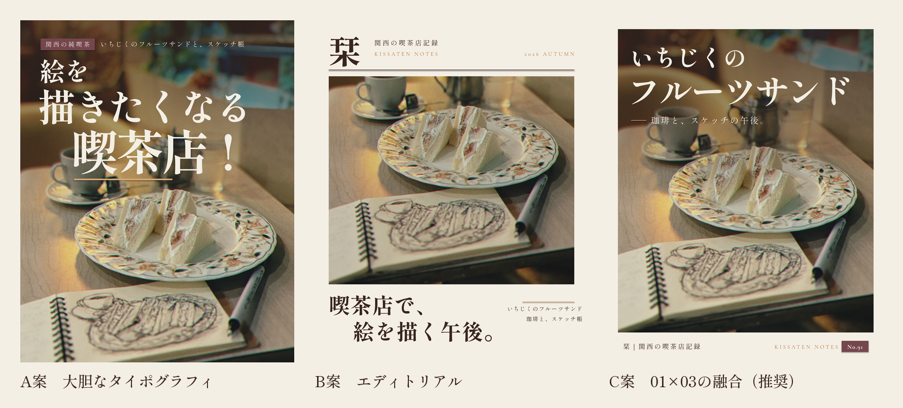

# 栞 サムネイル v2 —「強い入口 × 静かな余韻」

## 前提（確認できなかったこと）
- 参考01（pin 655062708337075295）、参考03（pin 34058540926344826）、追加の検索リンク5件は、この作業環境のネットワーク制限で開けませんでした。
- 参考画像の見た目は推測で再現していません。指示文に書かれた「取り入れる要素」の原則だけを使っています。
- 参考スクリーンショットをもらえれば、文字の比率や配置を照らし合わせて調整します。

## 納品物（`v2/out/`）
| 種類 | ファイル |
|---|---|
| 完成サムネイルPNG | `thumb_A.png` / `thumb_B.png` / `thumb_C.png`（1080×1350） |
| Canva編集用PPTX | `shiori_v2_ABC.pptx`（3案まとめ）、`shiori_v2_A/B/C.pptx`（案ごと） |
| テンプレート | `shiori_v2_template.pptx`、プレビュー `template_A/B/C.png` |
| 3案の比較 | `compare_ABC.png` |
| 一覧表示の縮小プレビュー | `grid_actual_size.png`（スマホ実寸相当：3:4切り抜き・1タイル124px）、`grid_preview_x3.png`（同じものを3倍表示） |
| シリーズ確認 | `series_mock_C.png`（C型を3枚並べたイメージ。同じ写真の別トリミングで仮置き） |
| 生成 | `build.py`（レイアウト）、`render.sh`（PPTX → LibreOffice描画 → 検証画像）、`compose.py` |

PNGはPPTXそのものを描画したものです。PPTXでは、写真・オーバーレイ・タイトル（行ごと）・サブ・装飾線・ラベル・号数がすべて別のオブジェクトになっています。文字は画像に焼き込んでいません。

## 3案の設計

### A案　大胆なタイポグラフィ（参考01寄り）
- 「絵を／描きたくなる／喫茶店!」を **100 → 148 → 188px** と3段階で大きくしています。読み進めるほど文字が大きくなり、最後の「喫茶店!」に視線が着地します。
- 各行の左端をずらしています（76 → 70 → 200px）。字間は大きい行ほど詰めています（−2 → −8 → −10px）。
- ボルドーの小さなラベル「関西の純喫茶」は、純喫茶の看板やメニュー札のような役割です。その右にサブを置いています。
- 琥珀色の下線で「喫茶店」を受けています。

### B案　エディトリアル（参考03寄り）
- 雑誌の表紙の構成にしています：**誌名「栞」**（128px）、副題「関西の喫茶店記録」、号表記「KISSATEN NOTES / 2026 AUTUMN」、罫線、写真、特集見出し。
- 見出し「喫茶店で、／絵を描く午後。」はダークブラウンの太い明朝84px。2行目を96px右にずらして、余韻を持たせています。
- サブは右揃えの小さな文字で、雑誌の特集リード文のように置いています。

### C案　01×03の融合（推奨・いちばん力を入れた案）
- **入口（01）**：「いちじくの」92px と「フルーツサンド」132px の2段組みです。主役の名前が、一覧の小さい表示でも一瞬で読めます。
- **余韻（03）**：写真をアイボリーの額縁（36px）に入れ、下に署名帯を設けています。署名帯には「栞｜関西の喫茶店記録」、KISSATEN NOTES、ボルドーの号数「No.91」を置きました。
- サブ「── 珈琲と、スケッチの午後。」で過ごし方（＝栞の人柄）を伝えます。
- **一冊の雑誌に見せる仕組み**：額縁・署名帯・号数の位置を全投稿で固定し、写真と2行の見出しだけを差し替えます（`series_mock_C.png` 参照）。号数が増えていくこと自体が「記録を続けている人」の証拠になり、フォローする理由になります。

> 号数「No.91」は「91投稿」というお話から仮に入れています。実際の番号に直してください（テキストボックスなので直接書き換えられます）。

## 完成前チェック（3案比較）
評価は `grid_actual_size.png`（スマホ実寸相当）と原寸PNGを見て行いました。◎ 十分、○ 概ね良い、△ 課題あり。

| 観点 | A | B | C |
|---|---|---|---|
| 1. 一覧画面でタイトルが読めるか | ◎ 3行とも読める。最も強い | ○ 見出しは読める。サブは読めない | ◎「フルーツサンド」がはっきり読める。サブは読めない |
| 2. 写真の主役を隠していないか | ○ サンドとスケッチは無傷。カップ（脇役）に3行目が重なる | ◎ 文字はすべて写真の外 | ○ サンドとスケッチは無傷。カップの上にサブが重なる |
| 3. 初見で内容が伝わるか | ○ 「喫茶店で絵」は伝わるが、メニューは小さいサブ頼み | △ 雰囲気は伝わるが、何の投稿かは写真頼み | ◎ メニュー名＋過ごし方で、具体と情景の両方が伝わる |
| 4. 栞らしい文学的な世界観 | △ 勢いが勝つ。明朝・ボルドー・琥珀色で品は保っている | ◎ 雑誌の表紙として最も静か | ○〜◎ 額縁・署名帯・号数で余韻が残る |
| 5. Canvaで編集できるか | ◎（Canvaで確認済み・下記） | ◎ | ◎ |
| 保存・フォローにつながる力（推測） | 目に留まる力は最大。フォローする理由は弱め | 統一感でプロフィールの格が上がる。単体では弱い | 号数・署名でシリーズ性が出て、フォローする理由が最も作りやすい |
| ブランドの一貫性（91投稿並べたとき） | △ 毎回これだと騒がしい | ○ 型は強いが、写真が小さく単調になりやすい | ◎ 額縁と署名帯が背表紙のように並ぶ |

**結論**：基本の型（毎回の型）はC案をおすすめします。A案は月1回程度の「特集号」（強いテーマの回）、B案はシリーズの表紙やまとめ投稿など、使う場面を分けるのが良いと考えます（ここからは推測を含みます。実際の反応はインサイトで確かめてください）。

## フォントとカラー
| 用途 | フォント | Canvaでの指定 |
|---|---|---|
| 和文見出し・サブ・署名 | しっぽり明朝（Shippori Mincho） | 見出しは太字ON。Canvaで同じ名前として認識されることを確認済み |
| 欧文（KISSATEN NOTES・号表記・号数） | Cormorant Garamond | 第2候補は EB Garamond |

| 名前 | HEX | 主な用途 |
|---|---|---|
| Ivory | `#F4EFE5` | 写真の上の文字、額縁、B案の地 |
| Dark Brown | `#38251F` | 紙の上の文字、罫線、オーバーレイ（不透明度：上端66〜70% → 下端0%） |
| Amber | `#B77B43` | 紙の上の欧文・装飾線 |
| Amber（写真の上用） | `#D9A877` | 写真の暗い部分に乗せる線（Amberのままだと沈むため、明るさだけ上げたもの） |
| Muted Bordeaux | `#75464D` | ラベル地・号数の地（1枚に1か所まで） |

## 文字サイズと配置（テンプレートのルール）
| 型 | 要素 | サイズ | 位置（x, y） |
|---|---|---|---|
| C（毎回の型） | 見出し1行目／2行目 | 92px／132px（字間 0／−6） | (84, 92)／(74, 198) |
| | サブ | 34px（字間 +5）＋琥珀の線 60px | (166, 374) |
| | 額縁・署名帯 | 額縁36px・署名帯 1232〜1350 | 署名 26px／号数 24px |
| A（特集号） | 見出し3行 | 100／148／188px | 左端を 76／70／200 にずらす |
| B（表紙・まとめ） | 誌名／見出し | 128px／84px×2行 | 見出しの2行目を +96px ずらす |

- 見出しの2行目は、最大8文字（C型は7文字・132pxで横幅いっぱい）。超えるときはサイズを下げます。
- 一覧画面の3:4表示では、左右が約34pxずつ切れます。文字は左右とも56px以上内側に置いています。
- C型では、上部（額縁の内側0〜420px）が暗く落ち着いた写真を選びます。上部に白い皿や明るい窓が来る写真では、白い文字が沈みます。

## Canvaでの確認と使い方
- 取り込み済みのデザイン：下記「Canvaリンク」を参照。
- 写真を差し替えるときは、新しい写真を写真枠にドラッグします。オーバーレイは別オブジェクトなので、写真に合わせて不透明度を調整してください。
- 号数・見出し・サブは、テキストを打ち替えるだけで使えます。

## 改善の具体的な提案
1. **撮影の段階からサムネを決める**：上部の1/3に背景のボケを残し、主役を画面の中央から下に置いて撮ります（今回の写真はこの条件を満たしていて、相性が良いです）。
2. **見出しの語彙を固定する**：1行目を「修飾（いちじくの／一杯の／琥珀色の）」、2行目を「名詞（主役）」にする文法で統一すると、91投稿並べたときに「栞の目次」として読めます。
3. **号数を本当の通し番号にする**：実際に訪れた店の数と揃えると、「記録」というアカウントの約束が強まります。
4. **A案は特集号に限定する**：「◯◯したくなる喫茶店!」の型は強いので、月1〜2回の特集テーマ（例：雨の日、読書に向く店）に使うと、効き目が落ちにくいです（推測）。
5. **検証**：最初はC型を3本続けて投稿し、プロフィールへのアクセス数とフォロー数を見ます。次にA型を1本入れて比較します。グリッドで同じ写真が重複しないようにします。
6. **参考画像との照合**：参考01と参考03のスクリーンショットをもらえれば、文字のサイズ比と余白の比率を数値で照らし合わせて、仕上げを調整できます。
